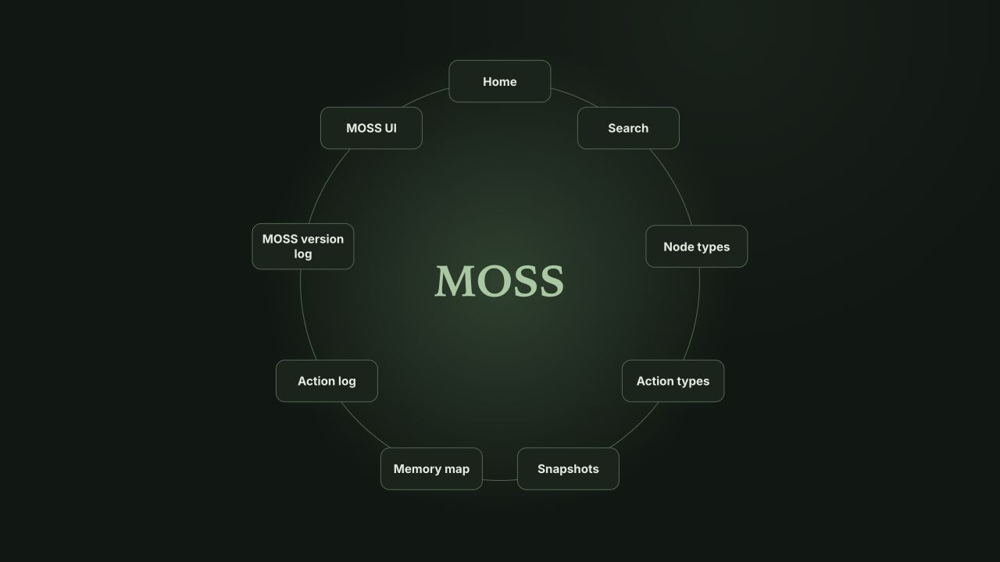

# MOSS

**v1.1.0**

MOSS is a local system for creating and connecting nodes: pages, notes, tasks,
lists, schedules, and other content. You choose the structure, use the included
node types, and extend the code when you need new behavior or ways to display it.

An organizational workspace is one example. A project page can bring together
notes, a task list, a calendar, and references. A scratchpad can collect rough
ideas before you organize them. The same parts can support a reference library,
a collection, or a workspace shaped around your own process.

Python handles storage and validation; HTML, CSS, and JavaScript provide the
web interface. Data lives in ordinary local files. MOSS runs without a database,
frontend build step, or MOSS account. You can work directly in the interface or
ask an agent with local file access to organize and extend it.

## Start the web interface

You need Git and Python 3.10 or newer. This release was tested on macOS with
Python 3.14.7. The commands below work in a macOS or Linux terminal, including
VS Code's integrated terminal. Windows command equivalents are below.

Clone the repository and install dependencies once:

```sh
git clone https://github.com/txknown/MOSS.git
cd MOSS
python3 -m venv .venv
.venv/bin/python -m pip install -r requirements.txt
```

If you already have the code, open a terminal in its folder and start with the
virtual environment step. For an existing workspace, read the
[upgrade instructions](docs/backup-and-upgrade.md#upgrade-from-v100) first.

Launch:

```sh
.venv/bin/python start_web.py
```

The browser opens at <http://127.0.0.1:8766/>. The first launch creates a local
`memory/` directory containing only an empty **Home** page. The defaults are
**MOSS light**, **Node** startup, and generic navigation links. There are no
sample notes, personal shortcuts, or starter kits bundled with this release.

Keep the terminal open while using MOSS. **Ctrl+C** stops the server. To return,
run the launch command again; reinstall dependencies only when needed for an
update. If the browser does not open automatically, visit the address above.

If port 8766 is occupied, the launcher exits without opening another workspace.
Each installation uses its own data directory, regardless of the terminal's
current folder. The server listens only on this computer's loopback address.

On Windows PowerShell, after cloning and entering the folder:

```powershell
py -3 -m venv .venv
.\.venv\Scripts\python.exe -m pip install -r requirements.txt
.\.venv\Scripts\python.exe start_web.py
```

The Windows commands are provided for convenience; this release's interactive
verification was performed on macOS.

## Build your first workspace

1. On **Home**, expand **Edit**, find **Create child**, choose **Page**, give it
   a title such as “Projects,” and click **Create**.
2. Open that page and create a **Note** for some writing or a **Todo List** for
   next steps. Nodes can also link existing children and reorder them.
3. Add a **Scratchpad** to Home for quick jots. Its parent preview contains a
   composer; opening the scratchpad shows previous jots, newest first.
4. Use **Search** to find content and **Memory map** to inspect relationships.
   A node's **Node attributes** section includes its ID for linking elsewhere.

These are suggestions, not a required folder structure. One node can be linked
from multiple parents. Unlinking it removes that relationship; deleting it
removes the node itself and its incoming references. Child nodes are retained
when a parent is deleted. Scratchpad trash buttons permanently delete the
confirmed text jot, including when it is linked elsewhere. Take a snapshot
before changes you may want to undo.

The included node types are:

| Types | Purpose |
| --- | --- |
| Page, Note, Text | Structure, titled writing, and inline text. |
| Scratchpad | Quick jots stored as ordinary Text children. |
| Todo List, Todo Item | Tasks and nested checklists, with new tasks first. |
| Calendar, Week, Event | Weekly schedules, timed events, and untimed day items. |
| Item List, Item | Collections whose entries share named fields. |
| Log, Log Entry | Reusable prompts and answers, including date, text, choices, and checkboxes. |
| Image, Link, Internal Link | Local images, web references, nodes, and built-in system views. |
| Randomizer | Random selections from lines of text. |

**Calendars:** create a Week with a Monday start date, open it, and use **Add
item**. Select **Timed event** or **Day item (no time)**. Untimed items appear
above the day's schedule. Timed events occupy proportional positions on a fixed
24-hour grid, with compressed overnight hours and overlapping boxes when times
overlap. Weeks also have a **Notes & goals** section. Date entry uses
`YYYY-MM-DD`; week cards show abbreviated months and the year.

**Logs:** configure prompts in the log's editor. Checkbox prompts provide
Yes/No answers. Each entry keeps its own prompt snapshot, so editing a template
does not reinterpret older entries.

**Randomizers:** selections link to the node. The heading is hidden in parent
previews by default; **Show title on parent page** enables it.

**Images:** place the image file in `memory/materials/` and use a source such as
`materials/example.png`. Image paths outside that directory are not served.
Node text is plain text; HTML and Markdown are not executed or rendered as markup.

## Appearance and navigation



The optional top-down view in MOSS dark. New installations start at Home in MOSS light.

Open **MOSS UI** in the top bar to choose:

- A saved **MOSS light** or **MOSS dark** color scheme.
- **Node** startup, using the configured home node ID, or **Show top-down**.
- Top-bar links to **Home**, an existing **Node** by ID, or a built-in view such
  as Search or Memory map. Set their labels, reorder them, and remove links.

Click **Save UI settings** to apply changes. **MOSS UI** stays available as a
fixed link. **Home** follows the configured home node. Clicking the **MOSS**
brand opens the top-down view, which uses the same navigation list. It shows a
circle at ordinary desktop sizes and a grid on small screens or with many links.
Selecting a destination opens its usual interface. Direct node URLs always open
that node, regardless of the startup preference.

A node's **Edit → Display styles** section has separate selectors for **On a
parent page** and **When opened**. All start at **Default**. Calendar also offers
**Current week** in parent previews: it displays existing week nodes containing
today, including their events and day items. It uses the browser's local date
and never creates a missing week. The normal opened-calendar view is unchanged.

MOSS UI includes an expandable catalog of display styles by node type. Ask an
AI2 agent to add a reusable style or saved color scheme when you need one; this
release does not include a visual style builder. Removed or incompatible display
styles fall back to Default. A node uses the same parent style wherever it appears.

Presentation choices live outside node content. See the
[architecture and extension guide](docs/architecture.md).

## Launch from any folder with zsh

For an optional `moss-web` command, add this function to `~/.zshrc`. Replace the
path with the absolute path to this installation; `pwd` prints it when you are
in the repository folder.

```zsh
moss-web() {
  local moss_dir="/absolute/path/to/MOSS"
  "$moss_dir/.venv/bin/python" "$moss_dir/start_web.py"
}
```

Load it in the current terminal, then launch:

```zsh
source ~/.zshrc
moss-web
```

New zsh terminals load the function automatically. If you move the installation,
update the path. Stop it with **Ctrl+C** in the terminal that launched it.

## Your data and backups

```text
memory/
  nodes/       Node metadata and plain-text content
  materials/   Local images and other referenced files
  system/      Registry, counters, and workspace presentation settings
  logs/        Recorded actions
snapshots/     ZIP backups created through MOSS
```

The repository contains no workspace data. Later launches reuse existing memory;
they do not reset it. Data is stored as ordinary unencrypted local files.

**Snapshots** creates and downloads ZIP backups of memory and its version
information. Snapshots do not contain the application source code. See
[backup, recovery, and upgrading](docs/backup-and-upgrade.md) for exact steps.

`memory/`, `snapshots/`, virtual environments, and caches are excluded by
`.gitignore`. A manual folder copy or ZIP does not apply Git ignore rules.
Keep workspace data and backups private when sharing the source code.

## Two kinds of history

**Action log** records changes made through MOSS actions: creating nodes,
editing content, changing display settings, and other workspace operations.

**MOSS version log** displays code releases from `change_log.json`. This release
is **v1.1.0**; `version.txt` identifies the installed version. Code changes get
release notes. Adding notes or checking off tasks does not change the code version.

## Agents and extensions

Read [the agent guide](docs/agents.md) to connect an agent with local file and
Python access. It includes a read-only inspection example, explicit action
examples, and guidance for organizing notes without losing original wording.
MOSS does not bundle an AI model or run an agent in the background.

Nodes, actions, and display styles can be extended independently. Domain rules
live in Python; browser modules own rendering. The
[architecture guide](docs/architecture.md) explains the six parts of MOSS and
where to add each kind of extension. [AGENTS.md](AGENTS.md) records the repository
constraints for agents making code changes.

## Terminal interface

A terminal interface shares the same local memory:

```sh
.venv/bin/python start_moss.py
```

Type `help` for commands. The browser provides the full presentation-settings
and specialized editing interfaces; browser display styles do not alter terminal
rendering. Use one writer at a time: concurrent agents or separate terminal/web
processes do not share a cross-process write lock.

## Development checks

From the repository folder:

```sh
.venv/bin/python -B -m unittest discover -s tests -v
```

Tests use temporary synthetic workspaces. Node.js is not needed to run MOSS.
Install Node.js 22.7 or newer to include JavaScript syntax and renderer tests;
those checks are skipped if Node.js is unavailable. Release verification used
Node.js 24.19.0. `requirements.txt` records the tested direct Python dependencies.

## License

MOSS is free to use, modify, and share under the [MOSS Free Use License](LICENSE).
The license includes the project's mission request concerning **MOSS**, **AI2**,
and **186**.
